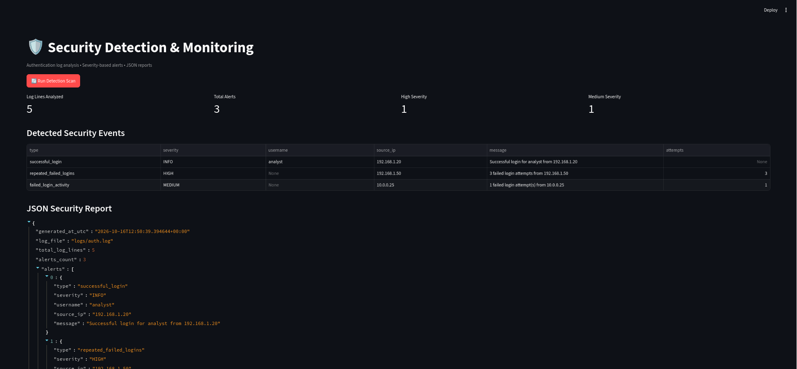

# Security Detection & Monitoring System

A Python-based cybersecurity project that analyzes authentication
logs, identifies suspicious login activity, generates severity-based
alerts, and saves a structured JSON security report.

## Features

- Authentication log analysis
- Detection of repeated failed login attempts
- Identification of successful login events
- Severity classification: INFO, MEDIUM, HIGH
- Automatic JSON report generation
- Sample logs for a reproducible demonstration
- Automated unit tests

## Technology Stack

- Python 3
- Linux / Kali Linux
- Regular expressions
- JSON
- Python unittest

## Project Structure

text
security-detection-monitor/
├── logs/
│   └── auth.log
├── src/
│   └── detector.py
├── reports/
├── tests/
│   └── test_detector.py
├── .gitignore
├── requirements.txt
└── README.md

## Live Demo

[Launch Security Detection & Monitoring Dashboard](https://security-detection-monitor-vaibhav-official-qexgtszj8nwi85x.streamlit.app)

